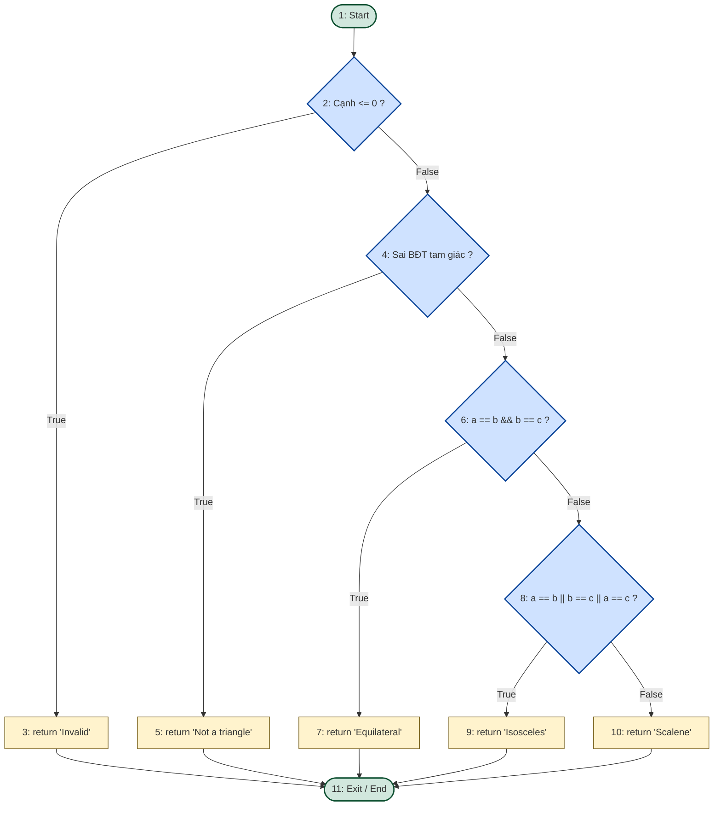

# BÁO CÁO BÀI TẬP LAB 3: KIỂM THỬ HỘP TRẮNG (WHITE-BOX TESTING)

* **Môn học:** Kiểm thử phần mềm (Software Testing)
* **Sinh viên thực hiện:** Vũ Hồng Phúc
* **Chủ đề:** Phân tích luồng điều khiển & Thiết kế ca kiểm thử hộp trắng cho phương thức `Triangle.classify`

---

## 1. Mã nguồn chương trình (Java)

```java
public class Triangle {
    public static String classify(int a, int b, int c) {
        if (a <= 0 || b <= 0 || c <= 0) {
            return "Invalid";
        }
        if (a + b <= c || a + c <= b || b + c <= a) {
            return "Not a triangle";
        }
        if (a == b && b == c) {
            return "Equilateral";
        } else if (a == b || b == c || a == c) {
            return "Isosceles";
        } else {
            return "Scalene";
        }
    }
}
```

---

## 2. Control Flow Graph (CFG)

### Danh sách các nút (Nodes):
* **Nút 1:** Điểm bắt đầu phương thức (`Start`).
* **Nút 2:** Quyết định 1: `if (a <= 0 || b <= 0 || c <= 0)`
* **Nút 3:** Xử lý: `return "Invalid";`
* **Nút 4:** Quyết định 2: `if (a + b <= c || a + c <= b || b + c <= a)`
* **Nút 5:** Xử lý: `return "Not a triangle";`
* **Nút 6:** Quyết định 3: `if (a == b && b == c)`
* **Nút 7:** Xử lý: `return "Equilateral";`
* **Nút 8:** Quyết định 4: `else if (a == b || b == c || a == c)`
* **Nút 9:** Xử lý: `return "Isosceles";`
* **Nút 10:** Xử lý (khối else): `return "Scalene";`
* **Nút 11:** Điểm kết thúc phương thức (`Exit / End`).

### Sơ đồ dòng điều khiển:



---

## 3. Cyclomatic Complexity (Độ phức tạp chu trình)

Theo cấp độ câu lệnh điều kiện rẽ nhánh chính (Decision-to-Decision paths):
* Số điểm quyết định (Predicate Nodes): P = 4 (tại các nút 2, 4, 6, 8).
* Công thức tính McCabe:
  V(G) = P + 1 = 4 + 1 = 5

**Kết luận:** Đồ thị có độ phức tạp chu trình V(G) = 5, tương ứng cần tối thiểu 5 ca kiểm thử độc lập để bao phủ toàn bộ luồng điều khiển của hàm.

---

## 4. Các đường đi độc lập (Independent Paths)

1. **Path 1 (Tam giác không hợp lệ):** 1 -> 2 -> 3 -> 11
2. **Path 2 (Không tạo thành tam giác):** 1 -> 2 -> 4 -> 5 -> 11
3. **Path 3 (Tam giác đều):** 1 -> 2 -> 4 -> 6 -> 7 -> 11
4. **Path 4 (Tam giác cân):** 1 -> 2 -> 4 -> 6 -> 8 -> 9 -> 11
5. **Path 5 (Tam giác thường):** 1 -> 2 -> 4 -> 6 -> 8 -> 10 -> 11

---

## 5. Thiết kế bộ Test Case

### a. 100% Statement Coverage (Bao phủ câu lệnh)

| Mã Test Case | Đường đi | Đầu vào (a, b, c) | Kết quả mong đợi | Mục tiêu bao phủ |
| :--- | :--- | :--- | :--- | :--- |
| **TC_ST_01** | Path 1 | (0, 4, 5) | "Invalid" | Thực thi return "Invalid"; |
| **TC_ST_02** | Path 2 | (1, 2, 3) | "Not a triangle" | Thực thi return "Not a triangle"; |
| **TC_ST_03** | Path 3 | (3, 3, 3) | "Equilateral" | Thực thi return "Equilateral"; |
| **TC_ST_04** | Path 4 | (3, 3, 4) | "Isosceles" | Thực thi return "Isosceles"; |
| **TC_ST_05** | Path 5 | (3, 4, 5) | "Scalene" | Thực thi return "Scalene"; |

### b. 100% Branch Coverage (Bao phủ nhánh)

| Mã Test Case | Nhánh kiểm thử | Đầu vào (a, b, c) | Trạng thái nhánh | Kết quả mong đợi |
| :--- | :--- | :--- | :--- | :--- |
| **TC_BR_01** | Nhánh True Nút 2 | (-1, 3, 4) | Nút 2 = True -> Nút 3 | "Invalid" |
| **TC_BR_02** | Nhánh True Nút 4 | (1, 2, 5) | Nút 2 = False, Nút 4 = True -> Nút 5 | "Not a triangle" |
| **TC_BR_03** | Nhánh True Nút 6 | (5, 5, 5) | Nút 2, 4 = False, Nút 6 = True -> Nút 7 | "Equilateral" |
| **TC_BR_04** | Nhánh True Nút 8 | (5, 5, 6) | Nút 2, 4, 6 = False, Nút 8 = True -> Nút 9 | "Isosceles" |
| **TC_BR_05** | Nhánh False toàn bộ | (4, 5, 6) | Nút 2, 4, 6, 8 = False -> Nút 10 | "Scalene" |