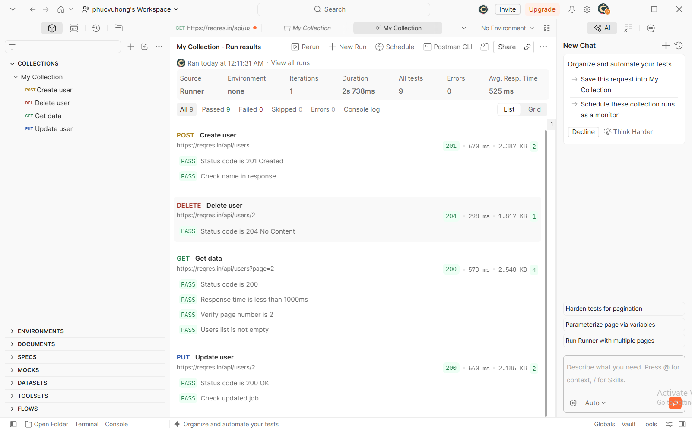

# BÁO CÁO THỰC HÀNH LAB 7: KIỂM THỬ API BẰNG POSTMAN

- **Học phần:** Kiểm thử phần mềm (Software Testing)
- **Sinh viên thực hiện:** Vũ Hồng Phúc
- **Công cụ sử dụng:** Postman Desktop App
- **Hệ thống API thực nghiệm:** ReqRes API (`https://reqres.in/`)

---

## 1. Mục tiêu kiểm thử
- Áp dụng đầy đủ 4 phương thức HTTP chuẩn CRUD: `GET`, `POST`, `PUT`, `DELETE`.
- Kiểm tra tính chính xác của Status Code, Response Body, và Response Time.
- Tự động hóa việc xác thực kết quả (Test Assertions) bằng ngôn ngữ JavaScript.
- Thực thi kiểm thử hồi quy tự động cho toàn bộ bộ kiểm thử với công cụ Collection Runner.

---

## 2. Danh sách ca kiểm thử API (Test Suite)

| STT | Tên Request | Method | Endpoint / URL | Mã Status Code mong đợi |
| :---: | :--- | :---: | :--- | :---: |
| 1 | **Create user** | `POST` | `https://reqres.in/api/users` | `201 Created` |
| 2 | **Delete user** | `DELETE` | `https://reqres.in/api/users/2` | `204 No Content` |
| 3 | **Get data** | `GET` | `https://reqres.in/api/users?page=2` | `200 OK` |
| 4 | **Update user** | `PUT` | `https://reqres.in/api/users/2` | `200 OK` |

---

## 3. Kịch bản kiểm thử chi tiết và Test Scripts

### 3.1. POST - Create user
- **URL:** `https://reqres.in/api/users`
- **Body (raw - JSON):**
```json
{
    "name": "Vu Hong Phúc",
    "job": "Software Tester"
}
```
- **Test Script:**
```javascript
pm.test("Status code is 201 Created", function () {
    pm.response.to.have.status(201);
});
pm.test("Check name in response", function () {
    var jsonData = pm.response.json();
    pm.expect(jsonData.name).to.eql("Vu Hong Phúc");
});
```

### 3.2. DELETE - Delete user
- **URL:** `https://reqres.in/api/users/2`
- **Test Script:**
```javascript
pm.test("Status code is 204 No Content", function () {
    pm.response.to.have.status(204);
});
```

### 3.3. GET - Get data
- **URL:** `https://reqres.in/api/users?page=2`
- **Test Script:**
```javascript
pm.test("Status code is 200", function () {
    pm.response.to.have.status(200);
});
pm.test("Response time is less than 1000ms", function () {
    pm.expect(pm.response.responseTime).to.be.below(1000);
});
pm.test("Verify page number is 2", function () {
    var jsonData = pm.response.json();
    pm.expect(jsonData.page).to.eql(2);
});
pm.test("Users list is not empty", function () {
    var jsonData = pm.response.json();
    pm.expect(jsonData.data.length).to.be.above(0);
});
```

### 3.4. PUT - Update user
- **URL:** `https://reqres.in/api/users/2`
- **Body (raw - JSON):**
```json
{
    "name": "Vu Hong Phúc",
    "job": "Senior QA Engineer"
}
```
- **Test Script:**
```javascript
pm.test("Status code is 200 OK", function () {
    pm.response.to.have.status(200);
});
pm.test("Check updated job", function () {
    var jsonData = pm.response.json();
    pm.expect(jsonData.job).to.eql("Senior QA Engineer");
});
```

---

## 4. Kết quả chạy tự động (Collection Runner Results)

- **Tổng số ca kiểm thử (Assertions):** 9 tests
- **Kết quả thực thi:** Passed 9/9 (100% Passed, 0 Failed, 0 Errors)



---

## 5. Tệp đính kèm
- File Collection xuất từ Postman: `Lab7_Postman_Collection.json`