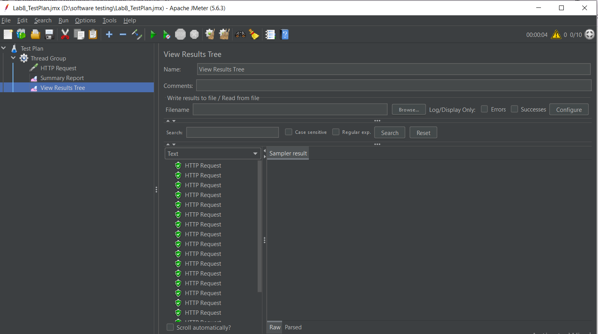
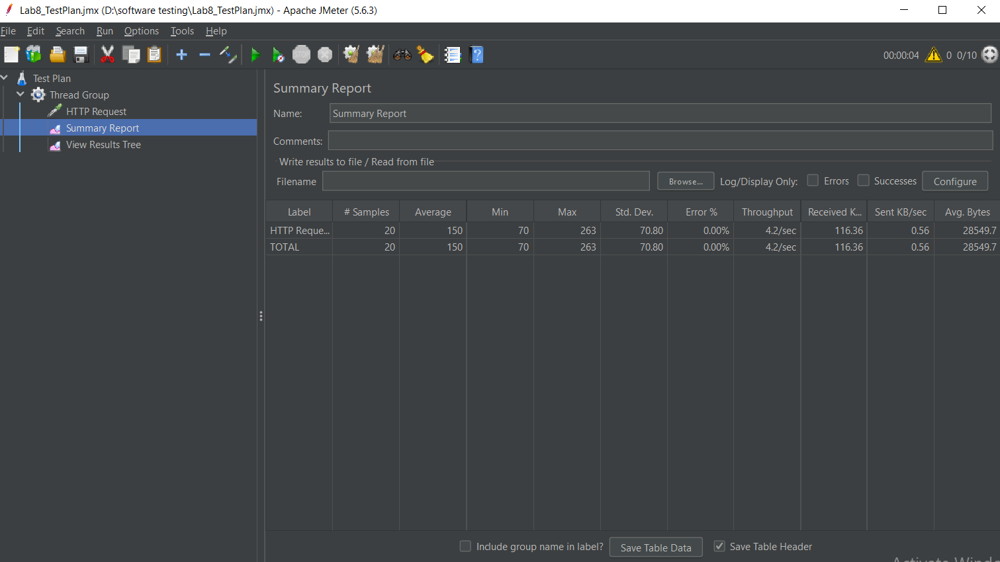

# BÁO CÁO THỰC HÀNH LAB 8: KIỂM THỬ HIỆU NĂNG VỚI APACHE JMETER

- **Học phần:** Kiểm thử phần mềm (Software Testing)
- **Sinh viên thực hiện:** Vũ Hồng Phúc
- **Công cụ sử dụng:** Apache JMeter 5.6.3
- **Hệ thống thực nghiệm (SUT):** JSONPlaceholder REST API (`https://jsonplaceholder.typicode.com/posts`)

---

## 1. Mục tiêu bài thực hành
- Nắm vững kiến trúc và nguyên lý hoạt động của công cụ kiểm thử hiệu năng **Apache JMeter**.
- Thiết lập kịch bản kiểm thử tải (Load Testing) với các thành phần cốt lõi: **Thread Group**, **HTTP Request Sampler**, và **Listeners**.
- Đo lường và phân tích các chỉ số hiệu năng thực tế: Thời gian phản hồi trung bình (Average Response Time), Min/Max, Độ lệch chuẩn (Std. Dev.), Thông lượng (Throughput) và Tỷ lệ lỗi (Error %).

---

## 2. Thiết kế Kịch bản Kiểm thử (Test Plan Configuration)

### 2.1. Cấu hình tải người dùng (Thread Group)
| Thông số | Giá trị cấu hình | Ý nghĩa |
| :--- | :---: | :--- |
| **Number of Threads (Users)** | `10` | Giả lập 10 người dùng ảo truy cập đồng thời |
| **Ramp-up Period (seconds)** | `5s` | Thời gian khởi tạo toàn bộ 10 người dùng là 5 giây |
| **Loop Count** | `2` | Mỗi người dùng thực hiện lặp lại yêu cầu 2 lần |
| **Tổng số Request (Samples)** | `20` | Tổng cộng $10 \times 2 = 20$ HTTP Requests gửi tới Server |

### 2.2. Cấu hình HTTP Request Sampler
- **Protocol:** `https`
- **Server Name or IP:** `jsonplaceholder.typicode.com`
- **HTTP Method:** `GET`
- **Path:** `/posts`

---

## 3. Kết quả Thực thi Kiểm thử

### 3.1. Kết quả chi tiết từng Request (View Results Tree)
Toàn bộ 20/20 yêu cầu gửi đi đều hiển thị trạng thái thành công (khiên tích xanh lá cây) với mã phản hồi **`200 OK`**.

---

### 3.2. Bảng thống kê hiệu năng tổng hợp (Summary Report)

| Chỉ số đo lường | Kết quả thực tế | Đánh giá |
| :--- | :---: | :--- |
| **# Samples (Tổng số mẫu)** | `20` | Đạt đủ 20/20 requests theo kịch bản |
| **Average (Thời gian phản hồi TB)** | `150 ms` | Tốc độ phản hồi nhanh (< 200ms) |
| **Min / Max Response Time** | `70 ms` / `263 ms` | Biên độ dao động nhỏ, hệ thống ổn định |
| **Std. Dev. (Độ lệch chuẩn)** | `70.80` | Độ ổn định giữa các phiên truy cập tốt |
| **Error % (Tỷ lệ lỗi)** | `0.00%` | Không phát sinh lỗi nào khi chịu tải đồng thời |
| **Throughput (Thông lượng)** | `4.2 /sec` | Xử lý trung bình 4.2 requests mỗi giây |

---

## 4. Tệp đính kèm trong Repository
- File kịch bản JMeter: `Lab8_TestPlan.jmx`
- Hình ảnh minh chứng: `jmeter_tree.png`, `jmeter_summary.png`